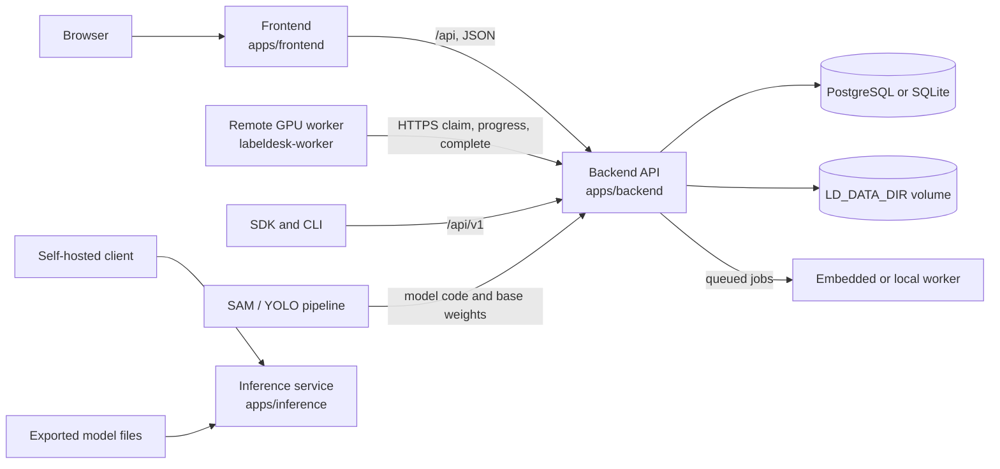

# Architecture overview

This document describes the runtime shape of LabelDesk and how it relates to the batch pipeline. It reflects the code on `feat/labeldesk-v2` at the time of writing. Paths use the planned `apps/frontend` and `apps/backend` names where possible, with the current directory in parentheses. The rename is pending.

## Context

The browser talks only to the frontend origin. In development Vite proxies `/api` to the API. In the Compose stack nginx serves the built frontend and proxies `/api` to the API container. A split deployment puts the web app on a static host and points it at the API origin with `VITE_API_URL`; the API then needs the web origin in `LD_CORS_ORIGINS`.

## Components

| Component | Current path | Responsibility |
|---|---|---|
| Backend API | `apps/backend` | FastAPI application, authentication, workspace and project data, job creation, file serving, hosted inference, remote worker endpoints |
| Frontend | `apps/frontend` | React 19 and Vite single-page app, annotation editor, dataset views, training and deployment screens |
| Local worker | `apps/backend/app/worker.py` | Claims queued jobs in the API process (`LD_EMBEDDED_WORKER=1`) or as `python -m app.worker` in the Compose worker service |
| Remote GPU worker | `apps/worker` | Outbound-only worker that claims `train` and `autolabel` jobs, runs them on its own GPU, and posts progress and results back |
| Self-hosted inference | `apps/inference` | Standalone service that serves exported `.onnx`, `.pt`, or `.engine` files over `/predict`; it has no workspace, API key, or billing code |
| SDK and CLI | `apps/sdk` | Python client for `/api/v1`; the operation map is generated from the API's OpenAPI schema |
| Batch pipeline | `sam3_auto_label`, `yolo26_ppe` | SAM auto-labeling and YOLO26 training, evaluation, and export. The target layout moves both under `ml/` |

The `packages/` directory in the target layout does not exist yet. Shared Python code currently lives under `apps/backend/app`. The frontend is self-contained.

## Request path

Routers are thin. A request enters through a router in `apps/backend/app/routers/`, resolves identity and workspace context in `deps.py`, and calls a service in `apps/backend/app/services/` or a model adapter in `apps/backend/app/adapters/`. Pydantic models handle request validation. Errors that reach a user are `ValueError` or `HTTPException` messages; internal detail goes to `log.exception`.

Workspace isolation is enforced in request queries, not by database row-level security. Every workspace-scoped query filters by `workspace_id`, and trained models are resolved through `resolve(ref, db, workspace_id=...)`. Any new query path has to keep that rule.

The main seams are:

- `adapters/`: one adapter per model family or runtime. The rest of the app resolves a model reference through the catalog and does not import Ultralytics, TensorRT, or vLLM directly.
- `services/`: business operations such as versioning, export, training finalization, privacy erasure, and insights. Routers call these; services do not depend on HTTP.
- `routers/`: HTTP shape only. Feature routers are registered in `main.py`; adding a feature should not require editing another feature's router.
- `jobs.py` and `worker.py`: cancellation and job execution. Handlers are registered by kind, and a startup assertion fails if a local job kind has no handler.

## Jobs and workers

The `jobs` table is the queue. There is no Redis or external broker. A process claims a row with a compare-and-set update from `queued` to `running`, which prevents two workers from running the same job.

Local kinds run in the API process when `LD_EMBEDDED_WORKER=1`, or in a separate worker process when it is `0`. The default `LD_LOCAL_JOBS` list covers version, export, health scans, connector sync, retention, video frame extraction, tracking, drift, active learning, and insights scans, and it also includes `train` and `autolabel`. With the defaults, a Train or Auto-label job therefore runs in the API process, on CPU when there is no GPU. The remote path is opt-in: remove `train,autolabel` from `LD_LOCAL_JOBS` (the Compose stack already does this for its `worker` service) and a `labeldesk-worker` claims them over HTTPS using `LD_WORKER_TOKEN`.

A crash leaves rows in `running`. When a local worker starts, `worker.recover()` puts running jobs back to `queued` and turns `cancelling` rows into `cancelled`, filtered by the effective `LD_LOCAL_JOBS` list. The development default includes `train` and `autolabel`, so a crashed training row is requeued and starts over. The Compose stack removes both kinds from the list, so there they are left in `running`. See the [recovery runbook](../runbooks/recovery-after-shutdown.md) for the operational consequence.

The GPU lease ledger in `apps/backend/app/gpu.py` is process-local. That is why the API image runs one uvicorn worker. Training and other exclusive GPU work take a lease; inference does not load a model outside one.

## Data and storage

| Data | Location | Notes |
|---|---|---|
| Relational data | `DATABASE_URL` | PostgreSQL in Compose, SQLite by default in development |
| Uploaded images, versions, exports, weights, engines | `LD_DATA_DIR` | A volume in Compose; `apps/backend/data` in development |
| Schema | Created by `Base.metadata.create_all` plus `ensure_columns` | Columns are added, not dropped |
| Secrets at rest | Encrypted in the database | Key derived from `LD_SECRET`; rotation uses `LD_SECRET_OLD` |

Files are served through signed, expiring URLs. The signature covers the relative path and expiry, so a stored file URL is not a general filesystem read.

Streams are different from uploaded video. A stream worker lives in the API process, and startup marks every stream row `stopped` because a restart forgets the in-process workers. Streams have to be started again after a restart.

## Front and back contract

The backend publishes the FastAPI OpenAPI document. The SDK operation map is generated from it by `tools/gen_sdk.py`, and `apps/backend/tests/test_sdk_cli.py` keeps the committed map in lockstep.

The frontend does not consume generated types yet. `apps/frontend/src/lib/types.ts` and `apps/frontend/src/lib/api.ts` are maintained by hand. The planned contract, where frontend types are generated from the same schema and a mismatch fails the frontend build, is recorded in [ADR 0002](../adr/0002-front-back-contract.md). Until that lands, an API shape change needs a matching frontend task and a manual type update.

## Deployment

`deploy/docker-compose.yml` defines:

- `caddy` for TLS and reverse proxy,
- `web` for the built frontend and `/api` proxy,
- `api` for the single-process backend,
- `worker` for CPU jobs,
- `db` for PostgreSQL,
- `inference` behind the optional `inference` profile.

GPU training is outside this stack. `labeldesk-worker` runs on a machine with a GPU and makes outbound HTTPS calls to the API. The deployment walkthrough and the `LD_SECRET` rotation procedure are in [docs/DEPLOY.md](../DEPLOY.md).

## What is not here

- No repository split. The frontend, backend, workers, and pipeline stay in one repository.
- No shared package directory yet. The target `packages/` layout is planned.
- No payment processor and no mandatory outbound email.
- No multi-process API. Rate limits, stream state, and the GPU ledger are in memory.
- No automatic repair for a remote worker that dies mid-job. The queue behavior is described in the recovery runbook.
